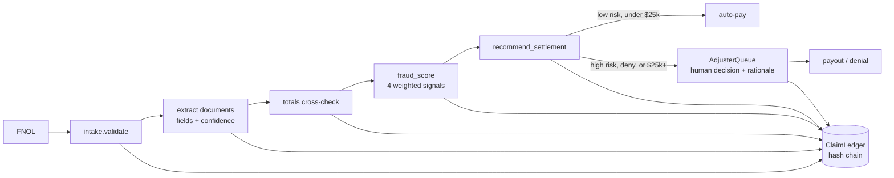

# Jagadish-insurance-claims-agents

[](https://github.com/jagadishmazure-jpg/Jagadish-insurance-claims-agents/actions/workflows/ci.yml)
[](https://github.com/jagadishmazure-jpg/Jagadish-insurance-claims-agents/actions/workflows/codeql.yml)


**Insurance claims from first notice of loss to payout: validation, document extraction, explainable fraud scoring, settlement recommendation and a human adjuster gate, all on a hash-chained ledger.**

> Personal learning and portfolio project. Everything runs offline on synthetic,
> fictional data with no API keys. Nothing is deployed. Numbers in this README
> come from real runs and are re-checked by CI (`scripts/render_docs.py --check`).

## Recruiter summary

- Six-stage claims pipeline for a fictional auto, property and health insurer, with straight-through processing only where it is safe.
- Real run: a duplicate, inflated claim on a 2-day-old policy scores 80 (HIGH) on three cited signals and goes to investigation; a clean $5,000 claim auto-pays; a clean $30,000 claim waits for a human.
- Deterministic offline tests; CI with lint, CodeQL, gitleaks and documented-output drift checks.

## Purpose

Claims teams face two problems at once: simple claims wait too long, and padded
or duplicate claims slip through manual review. This repo shows a pipeline that
pays small, clean, well-documented claims straight away, sends everything else to
a person with the evidence already assembled, and records each step on a ledger
an auditor can verify.

## Architecture



## How it works

| Stage | Module | What happens |
|---|---|---|
| Intake | `claims/intake.py` | Field, date and amount checks on the first notice of loss |
| Extraction | `claims/extract.py` | Regex extraction of claimant, date, total and line items, each with a confidence and the source snippet |
| Totals check | `claims/extract.py` | Line items must add up; the claimed amount is compared with the documented total |
| Fraud scoring | `claims/fraud.py` | Four signals (duplicate 35, inflated amount 25, date anomaly 20, claim velocity 20); tiers low under 35, medium 35-69, high 70+ |
| Recommendation | `claims/settle.py` | Pay, pay with deduction, investigate or deny, with a rationale list |
| Adjuster gate | `claims/adjuster.py` | High risk, any denial, and anything of $25,000 or more go to a person who must give a rationale |

The signal catalogue, with what each one cites as evidence, is in
[docs/fraud-signals.md](docs/fraud-signals.md).

## Real code and output

```python
"""Run three synthetic claims and a seeded batch through FNOL -> payout (offline, deterministic)."""
from collections import Counter
from datetime import date, timedelta

from claims import AdjusterQueue, ClaimLedger, gen_fnol, process_claim
from claims.intake import FNOL

TODAY = date(2026, 6, 20)


def estimate(total, claimant="Ava Reyes"):
    parts = round(total * 0.6, 2)
    return (f"Claimant: {claimant}\nDate: 2026-03-10\nTotal: ${total:,.2f}\n"
            f"- Parts: ${parts:,.2f}\n- Labor: ${total - parts:,.2f}\n")


def fnol(claim_id, amount, start=date(2026, 1, 1), incident=date(2026, 3, 10)):
    return FNOL(claim_id=claim_id, policyholder="Ava Reyes", policy_id="POL-1",
                policy_start=start, incident_date=incident, loss_type="auto",
                description="Rear-end collision at intersection; bumper damage.",
                claimed_amount=amount)


ledger, queue = ClaimLedger(), AdjusterQueue()
prior = fnol("CLM-0", 5_000.00, start=date(2026, 6, 1), incident=date(2026, 6, 3))
scenarios = [
    ("clean, small", fnol("CLM-1", 5_000.00), [(estimate(5_000.00), "repair_estimate")], []),
    ("clean, large", fnol("CLM-2", 30_000.00), [(estimate(30_000.00), "repair_estimate")], []),
    ("duplicate + inflated + new policy",
     fnol("CLM-3", 45_000.00, start=date(2026, 6, 1), incident=date(2026, 6, 3)),
     [(estimate(10_000.00), "repair_estimate")], [prior]),
]
for label, f, docs, history in scenarios:
    case = process_claim(f, docs, history=history, ledger=ledger, queue=queue, today=TODAY)
    fired = [s.name for s in case.fraud.fired_signals()]
    print(f"{case.claim_id} ({label}): fraud {case.fraud.composite:.0f} {case.fraud.tier.upper()}"
          f" fired={fired or '-'} -> {case.recommendation.action}"
          f" payable=${case.recommendation.payable_amount:,.2f}"
          f" {'queued: ' + case.queued_reason if case.queued_reason else 'auto-approved'}")

decision = queue.decide("CLM-3", "deny", "ADJ-7", "Duplicate of CLM-0 with an inflated amount.")
print(f"Adjuster ADJ-7 on CLM-3: {decision.decision}, final payable ${decision.final_payable:,.2f}")
print(f"Ledger entries: {len(ledger.entries)}, chain verifies: {ledger.verify_chain()}")

batch = gen_fnol(40, seed=42)
actions, tiers = Counter(), Counter()
for f in batch:
    c = process_claim(f, [(estimate(f.claimed_amount, f.policyholder), "repair_estimate")],
                      history=batch, today=f.incident_date + timedelta(days=5))  # reported 5 days after the loss
    actions[c.recommendation.action if c.recommendation else "invalid"] += 1
    tiers[c.fraud.tier if c.fraud else "n/a"] += 1
print(f"\nSeeded batch of {len(batch)} claims, matching estimates, each reported 5 days after the loss:")
print("  actions:", dict(sorted(actions.items())))
print("  fraud tiers:", dict(sorted(tiers.items())))
```

Output of `python examples/demo.py` (real run, re-checked in CI):

<!-- run: python examples/demo.py -->
```text
CLM-1 (clean, small): fraud 0 LOW fired=- -> pay payable=$5,000.00 auto-approved
CLM-2 (clean, large): fraud 0 LOW fired=- -> pay payable=$30,000.00 queued: amount meets human-review threshold
CLM-3 (duplicate + inflated + new policy): fraud 80 HIGH fired=['duplicate_claim', 'inflated_amount', 'date_anomaly'] -> investigate payable=$0.00 queued: routed to investigation (fraud tier high)
Adjuster ADJ-7 on CLM-3: deny, final payable $0.00
Ledger entries: 18, chain verifies: True

Seeded batch of 40 claims, matching estimates, each reported 5 days after the loss:
  actions: {'pay': 40}
  fraud tiers: {'low': 40}
```
<!-- /run -->

## How to run

```bash
git clone https://github.com/jagadishmazure-jpg/Jagadish-insurance-claims-agents.git
cd Jagadish-insurance-claims-agents
python -m pip install pytest      # no runtime dependencies
python -m pytest -q          # offline, no keys
python examples/demo.py
python scripts/render_docs.py --check   # documented output still matches
```

Test suite size (real collection, re-checked in CI):

<!-- run: python scripts/count_tests.py -->
```text
41 tests collected
```
<!-- /run -->

## Guardrails

- High fraud risk never auto-pays; it always goes to investigation.
- Every denial needs a human adjuster and a written rationale.
- Claims of $25,000 or more need a human even when the risk is low.
- Each fraud signal cites its evidence (the matching claim ID, the ratio, the day count).
- Every stage, decision and payout is on a hash-chained ledger that `verify_chain()` checks.

## Limitations

- Extraction is regex over plain text, not OCR or a document model.
- Signal weights and thresholds are hand-set, not calibrated on real loss data.
- The seeded batch of 40 claims all score low because their documents match; the repo has no labelled fraud set to measure precision and recall yet.
- Policies, people and amounts are synthetic; there is no policy-admin or payments integration.

## Built vs planned

| Capability | Status | Where |
|---|---|---|
| FNOL validation and seeded generator | Built | `claims/intake.py` |
| Document extraction with confidence and snippets | Built | `claims/extract.py` |
| Four-signal fraud score | Built | `claims/fraud.py` |
| Settlement recommendation and adjuster queue | Built | `claims/settle.py`, `claims/adjuster.py` |
| Hash-chained ledger | Built | `claims/audit.py` |
| Azure AI Document Intelligence extractor | Planned | docs/implementation-guide.md |
| Labelled fraud set with precision/recall | Planned | not started |
| Adjuster UI and payments integration | Planned | not started |

## Implementation guide

The step-by-step path from this offline build to an Azure deployment is in
[docs/implementation-guide.md](docs/implementation-guide.md). None of it has been
run; it is a plan.

## Related repositories

| Repo | How it relates |
|---|---|
| [Jagadish-fraud-detection-agents](https://github.com/jagadishmazure-jpg/Jagadish-fraud-detection-agents) | Same evidence-first fraud pattern on banking transactions |
| [Jagadish-document-intelligence](https://github.com/jagadishmazure-jpg/Jagadish-document-intelligence) | Richer document extraction and review that could replace the regex extractor |
| [Jagadish-agentic-data-layer](https://github.com/jagadishmazure-jpg/Jagadish-agentic-data-layer) | Its insurance domain (fictional Ferrowind) has the governed claims data products |
| [Jagadish-agentic-ai-model-risk](https://github.com/jagadishmazure-jpg/Jagadish-agentic-ai-model-risk) | Model risk controls for a claims fraud model |

## Documentation

- [Fraud signals catalogue](docs/fraud-signals.md)
- [Implementation guide (Azure)](docs/implementation-guide.md)
- [Interview points](docs/interview-points.md)
- [Security policy](SECURITY.md)

## Project layout

```
claims/
  intake.py     FNOL dataclass, validation, seeded generator
  extract.py    document extraction + totals check
  fraud.py      four weighted fraud signals and tiers
  settle.py     settlement recommendation
  adjuster.py   human adjuster queue and decisions
  audit.py      hash-chained ledger
  pipeline.py   process_claim(): the whole flow
examples/demo.py the run shown above
tests/           offline pytest suite
```

## License

MIT, see [LICENSE](LICENSE). All data is synthetic; every organisation and person is fictional.
